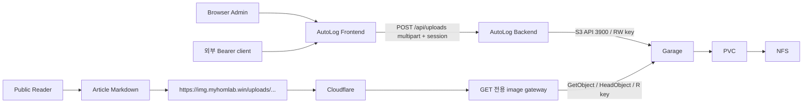

# Garage 이미지 업로드

기존 Article Markdown과 public blog/private CMS 인증을 유지한다. DB 테이블/migration은 추가하지 않는다.
추가 Python 의존성은 boto3, Pillow, python-multipart이며 lockfile에 버전/해시를 고정했다. Node 의존성은 추가하지 않는다.



## API와 파일 안전성

POST /api/uploads, multipart 필드 file. 기존 관리자 세션 또는 Bearer Token을 사용한다.
Cookie 요청은 기존 Origin/CSRF 검사도 유지한다. 인증은 multipart parsing/spooling 전에 검사한다.
10 MiB(10 × 1024 × 1024 bytes)보다 큰 파일은 413. Multipart 전체 body는 추가 64 KiB overhead까지 제한한다.
PNG/JPEG/WebP/GIF MIME만 허용하고 Pillow verify 및 pixel decode로 실제 포맷과 MIME 일치를 검사한다.
SVG/실행파일/깨진 이미지/MIME 위장은 415 또는 422이다. Decode 총량 40 MP, animation 최대 100 frame으로 제한한다.
원본 이름은 저장 key에 사용하지 않는다. UTC uploads/YYYY/MM/UUIDhex.ext key와 올바른 Content-Type으로 저장한다.
GIF/WebP animation은 검증 후 원본 bytes를 보존한다. 이미지 metadata도 보존되므로 공개 전 위치/개인정보를 확인한다.

성공 201: {"url":"https://img.myhomlab.win/uploads/YYYY/MM/UUID.png","key":"uploads/YYYY/MM/UUID.png"}.
미설정 storage/public URL은 503, S3 장애/권한/bucket 오류는 상세 credential을 숨긴 502다.
S3 설정 누락은 업로드만 비활성화하며 기존 CRUD/login/readiness에는 영향을 주지 않는다.
Article Action schema는 기존 Article 경로를 유지한다. upload API는 전체 /openapi.json에 있고 외부 클라이언트가 multipart로 호출할 수 있다.

## Backend 환경변수

| 변수 | 기본/위치 |
| --- | --- |
| S3_ENDPOINT | http://garage.lifelog.svc.cluster.local:3900 |
| S3_ACCESS_KEY | lifelog-garage-s3 Secret: S3_ACCESS_KEY |
| S3_SECRET_KEY | lifelog-garage-s3 Secret: S3_SECRET_KEY |
| S3_BUCKET | autolog-public |
| S3_PUBLIC_BASE_URL | https://img.myhomlab.win (아래 gateway 사용 시) |
| S3_REGION | garage (설치된 Garage의 s3_region과 일치시킬 것) |

S3_SECURE는 별도 사용하지 않으며 S3_ENDPOINT의 http/https scheme이 결정한다. TLS 검증은 기본 활성화한다.
S3_PUBLIC_BASE_URL은 HTTPS 공개 origin/optional path prefix다. 내부 .svc/.cluster.local 주소와 private IP를 거절한다.
Access/secret은 backend만 받으며 frontend/Markdown/이미지 응답으로 전달하지 않는다.
Garage에서 생성한 S3 key를 lifelog-garage-s3 Secret으로 주입한다. Garage RPC secret/admin token은 S3 credential이 아니다.
Backend에는 autolog-public bucket의 write 권한을 부여한다. 공개 gateway에는 별도 read-only S3 key를 사용하며 두 key를 공유하지 않는다.
Garage의 key 권한은 bucket 단위이므로 prefix/method 제한은 gateway에서도 반드시 적용한다.

## 운영 준비 완료 상태에서 배포

운영자가 확인한 준비 상태: Garage pod Running, layout 적용, autolog-public bucket 및 autolog-backend S3 key 생성,
bucket read/write 권한 부여, Website access=false, endpoint는 garage.lifelog.svc.cluster.local:3900이다.
이 상태에서는 bucket/key 생성과 --create/--public-read 초기화를 반복하지 않는다.
기존 key의 access/secret을 보호 파일에서 lifelog-garage-s3 Secret으로 등록한 뒤 아래 NetworkPolicy/S3 env patch와 새 이미지 rollout만 진행한다.
Website access=false를 유지하며 공개 이미지 제공은 별도 read-only signing gateway로 구성한다.
기존 autolog.myhomlab.win Cloudflare Tunnel은 변경하지 않는다.

## 적용 순서: 기존 운영 image/Cloudflare/DB/PVC 유지

관리 호스트에서 실행한다. image placeholder가 있는 backend Deployment 전체를 그대로 apply하지 않는다.
현재 Garage 라벨을 먼저 확인한다. garage.yaml은 app:garage를 가정하므로 실제 Service selector가 다르면 양쪽 selector를 맞춘다.

```bash
kubectl -n lifelog get svc garage -o jsonpath='{.spec.selector}'
kubectl -n lifelog get pods --show-labels
# Garage key 생성 후 access/secret을 별도 보호 파일에 저장한다. 값은 채팅/Git/명령 인자에 넣지 않는다.
# SECRET_DIR은 보호 파일 디렉터리다. S3_ACCESS_KEY/S3_SECRET_KEY 파일 권한은 0600으로 설정한다.
kubectl -n lifelog create secret generic lifelog-garage-s3 \
  --from-file=S3_ACCESS_KEY="$SECRET_DIR/S3_ACCESS_KEY" \
  --from-file=S3_SECRET_KEY="$SECRET_DIR/S3_SECRET_KEY"
kubectl -n lifelog get secret lifelog-garage-s3 -o name
# app:garage가 실제 selector일 때:
kubectl apply --dry-run=server -f k8s/networking/garage.yaml
kubectl apply -f k8s/networking/garage.yaml
```

이 정책은 backend → 같은 namespace의 Garage TCP 3900 egress/ingress만 추가한다.
Garage 관리 API/RPC/UI와 외부 접근은 열지 않는다. 기존 Cilium/OpenAI 정책과 additive하게 적용된다.

현재 ConfigMap의 DB/CORS/Tunnel 설정을 덮지 않도록 S3 항목만 merge한다.

```bash
kubectl -n lifelog patch configmap lifelog-config --type=merge -p '{"data":{
 "S3_ENDPOINT":"http://garage.lifelog.svc.cluster.local:3900",
 "S3_BUCKET":"autolog-public","S3_REGION":"garage",
 "S3_PUBLIC_BASE_URL":"https://img.myhomlab.win"}}'
cat > /tmp/autolog-s3-env.json <<'JSON'
{"spec":{"template":{"spec":{"containers":[{"name":"backend","env":[
 {"name":"S3_ACCESS_KEY","value":null,"valueFrom":{"secretKeyRef":{"name":"lifelog-garage-s3","key":"S3_ACCESS_KEY"}}},
 {"name":"S3_SECRET_KEY","value":null,"valueFrom":{"secretKeyRef":{"name":"lifelog-garage-s3","key":"S3_SECRET_KEY"}}},
 {"name":"S3_ENDPOINT","value":null,"valueFrom":{"configMapKeyRef":{"name":"lifelog-config","key":"S3_ENDPOINT"}}},
 {"name":"S3_BUCKET","value":null,"valueFrom":{"configMapKeyRef":{"name":"lifelog-config","key":"S3_BUCKET"}}},
 {"name":"S3_REGION","value":null,"valueFrom":{"configMapKeyRef":{"name":"lifelog-config","key":"S3_REGION"}}},
 {"name":"S3_PUBLIC_BASE_URL","value":null,"valueFrom":{"configMapKeyRef":{"name":"lifelog-config","key":"S3_PUBLIC_BASE_URL"}}}
]}]}}}}
JSON
kubectl -n lifelog patch deployment lifelog-backend --type=strategic \
  --patch-file /tmp/autolog-s3-env.json --dry-run=server
kubectl -n lifelog patch deployment lifelog-backend --type=strategic \
  --patch-file /tmp/autolog-s3-env.json
```

Secret 값이나 image는 이 patch에 없다. 신규 설치는 수정된 ConfigMap/Deployment와 기존 renderer를 사용할 수 있다.
다음으로 새 backend/frontend 이미지를 Podman build/push하고 기존 deploy-public-cms.sh로 rollout한다.
이 스크립트는 현재 image repository를 재사용하며 이미 추가한 S3 env를 유지한다. DB migration은 없다.

```bash
PUBLIC_URL=https://autolog.myhomlab.win bash scripts/deploy-public-cms.sh
# 새 backend 이미지가 실행 중이며 Garage 접속이 허용된 뒤, bucket 확인/생성:
kubectl -n lifelog exec -i deployment/lifelog-backend -- \
  python - --create < scripts/setup-image-bucket.py
```

업로드 요청은 bucket을 자동 생성하거나 정책을 변경하지 않는다. 위 setup은 bucket 존재 여부를 확인하고 없는 경우에만 생성한다.
Garage에서는 bucket policy API를 호출하지 않는다. 이미 준비된 bucket과 writer 권한은 그대로 유지한다.
공개 조회는 별도 reader key로 서명하는 독립 gateway가 담당한다. Website access=false를 유지한다.

## 공개 이미지 조회

[image-gateway 구현·Secret·Podman·Kubernetes·Cloudflare·롤백 절차](image-gateway.md)를 따른다.
새 image hostname 규칙만 기존 Tunnel fallback 앞에 추가하며 autolog hostname과 tunnel credential은 유지한다.

## 테스트와 운영 확인

```bash
cd backend
TEST_DATABASE_URL="$YOUR_TEST_DATABASE_URL" .venv/bin/python -m pytest -q --tb=short
# uploads 테스트는 S3를 mock하므로 실제 Garage가 필요 없다.
cd ../frontend
npm run typecheck
npm run build
```

/login → /admin → 작성/수정에서 이미지 설명과 파일을 선택한다. 업로드 성공 시 커서/선택 영역에 Markdown을 삽입한다.
PNG/JPEG/WebP/GIF만 선택 가능하며 실패 시 작성 내용을 보존하고 오류를 표시한다. 업로드 중 저장/본문 편집은 잠시 비활성화한다.
Markdown 미리보기와 published 상세에서 이미지가 표시되는지 확인한다. 공개/guest 화면에는 업로드 UI가 없다.

이미지 자체는 public bucket이므로 draft에 삽입한 이미지도 URL을 알면 읽을 수 있다.
글 삭제/업로드 취소가 Garage object를 삭제하지 않는다. 별도 테이블이 없어 참조/고아 파일 자동 추적도 하지 않는다.
공개 URL에 비밀 자료를 올리지 않는다. 익명 write/delete는 금지되며 object 관리 권한은 backend/관리 운영자만 가진다.

```bash
curl --fail https://img.myhomlab.win/uploads/실제-key.png --output /tmp/autolog-image.png
kubectl -n lifelog logs deployment/lifelog-backend --tail=100
kubectl -n lifelog describe deployment lifelog-backend
kubectl -n lifelog get networkpolicy
```

브라우저 자동화 검증도 저장소에 포함했다. 별도 Python 테스트 환경에 Playwright, Pillow와 Chromium을 설치한 뒤 실행한다.
테스트는 이름이 _test로 끝나는 전용 테스트 DB를 읽기만 하고 임시 backend/frontend 프로세스와 mock storage를 사용한다. 8101/3101 포트가 비어 있어야 한다.
기본 브라우저 경로는 /usr/bin/chromium이며 backend/.venv와 frontend production build가 준비돼 있어야 한다.

```bash
# 저장소 루트, 위 도구가 설치된 Python으로 실행
TEST_DATABASE_URL="$YOUR_LOCAL_TEST_DATABASE_URL" backend/.venv/bin/python scripts/check-image-upload-ui.py
```

## 이전 통신 정책 정리

Garage 업로드/조회 확인 후, 이전 스토리지의 정책이 클러스터에 설치되어 있다면 아래 두 정책만 제거한다.
아래 이름은 기존 리소스 삭제를 위한 의도적인 과거 명칭이며 런타임 설정/manifest에서는 사용하지 않는다.
Garage PVC/기존 DB/PVC나 Service, autolog.myhomlab.win Tunnel을 삭제하지 않는다.

```bash
kubectl -n lifelog delete networkpolicy allow-backend-minio-egress allow-backend-minio-ingress --ignore-not-found
```

## 롤백

backend와 frontend를 함께 이전 revision으로 rollout undo한다. DB/PVC/Garage bucket/object를 삭제하지 않는다.
S3 env와 추가 TCP 3900 정책은 이전 CRUD에 영향을 주지 않아 유지할 수 있다. 완전 비활성화하려면 해당 두 NetworkPolicy만 제거한다.
Tunnel image hostname을 비활성화하면 기존 Markdown image 링크가 깨지므로 백업/링크 보존을 먼저 검토한다.

```bash
kubectl -n lifelog rollout undo deployment/lifelog-backend
kubectl -n lifelog rollout undo deployment/lifelog-frontend
kubectl -n lifelog rollout status deployment/lifelog-backend
kubectl -n lifelog rollout status deployment/lifelog-frontend
```

이 클라우드 검증은 mocked S3를 사용했다. 실제 Garage/운영 NetworkPolicy/Tunnel/DNS 설정은 대상 클러스터 관리 호스트에서 확인해야 한다.
