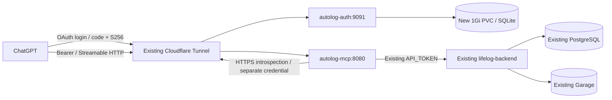

# AutoLog MCP 홈랩 인증 서버 배포 준비

기준: `work`의 `0e1048760a071b24aa0d64a65e163299e13521ba`, 검토일 2026-10-20.
이 문서는 운영 변경 승인이 아니다. 기존 lifelog·PostgreSQL·Garage·image-gateway·Cloudflare Tunnel·Sites 플러그인은 유지한다.

## 결정과 증거 수준

**Authelia 4.39.28을 검증 후보로 구현했다. 실제 실행과 ChatGPT 연결을 통과하기 전에는 최종 채택하지 않는다.**
단순히 Authelia가 안 될 것이라고 가정하거나 `iss/aud/exp/sub/scope` 검증을 제거해 맞추지 않는다.
현재 환경에는 Docker/Podman, kubectl/kubeconfig가 없고 외부 DNS 요청이 실패한다.
GitHub 읽기는 연결 도구로 가능하지만 GitHub tree 생성은 자동 승인 정책에 거부되었다.
원본 `.git`도 읽기 전용이다. 따라서 이 환경의 단위 테스트와 공식 문서/소스 검토는 실제 IdP 로그인·발급·ChatGPT 연결의 증거가 아니다.

| 후보 | 현재 코드와의 접점 | 관리/자원 관점 | 판단 |
| --- | --- | --- | --- |
| Authelia 4.39.28 | Code+S256, discovery, JSON introspection, resource/audience, custom scopes와 owner 정책을 설정 가능 | Go 단일 프로세스, 파일 사용자, SQLite, Redis 없이 단일 replica | 우선 실증 후보. 아래 gate 통과 필수 |
| Keycloak | 공식 MCP 안내는 resource indicators를 실험 기능으로 명시. 활성화 후 URI audience와 scope 검증 필요 | JVM과 전용 DB/schema/role 관리. 기존 PostgreSQL 인스턴스 재사용은 가능하나 앱 DB와 분리해야 함 | Authelia가 필수 계약에 실패할 때의 차순위 평가 대상. 테스트 없이 호환 확정하지 않음 |
| authentik | Code/PKCE, discovery, introspection 및 cross-provider introspection 설정 제공 | server/worker와 PostgreSQL 운영 및 정책 UI 관리 부담 | 1인 홈랩에서는 우선순위 낮음. resource 처리와 exact aud는 추가 실증 필요 |

세 제품의 오픈소스 배포만 고려한다. 이 구현에는 유료 SaaS/라이선스/체험판 의존성이 없다.
인증서 종료와 외부 경로에는 이미 사용하는 Cloudflare Tunnel을 재사용하며 유료 기능을 요구하지 않는다.

공식 근거:

- [Authelia OIDC 및 resource/audience 전략](https://www.authelia.com/integration/openid-connect/introduction/)
- [Authelia client 설정: PKCE, audience, scope, 사용자 authorization policy](https://www.authelia.com/configuration/identity-providers/openid-connect/clients/)
- [Provider 설정: custom scopes 및 정책](https://www.authelia.com/configuration/identity-providers/openid-connect/provider/)
- [고정 버전 설정 schema](https://github.com/authelia/authelia/blob/v4.39.28/internal/configuration/schema/identity_providers.go), [고정 버전 introspection handler](https://github.com/authelia/authelia/blob/v4.39.28/internal/handlers/handler_oauth2_introspection.go), [issuer 포함 session claims](https://github.com/authelia/authelia/blob/v4.39.28/internal/oidc/session.go)
- [Authelia 릴리스](https://github.com/authelia/authelia/releases/tag/v4.39.28)
- [Keycloak MCP 호환성과 resource indicators](https://www.keycloak.org/securing-apps/mcp-authz-server)
- [authentik OAuth provider](https://docs.goauthentik.io/add-secure-apps/providers/oauth2/)
- [ChatGPT 인증 계약](https://developers.openai.com/plugins/build/auth), [연결 UI](https://developers.openai.com/api/docs/guides/custom-mcp-server)

최신 웹 문서의 기능을 고정 이미지의 실제 동작으로 간주하지 않는다. 이미지 digest와 버전을 기록하고 그 이미지로 재시험한다.

## 필수 호환 계약

| 요구사항 | 설정/검증 지점 | 합격 조건 |
| --- | --- | --- |
| Code+PKCE S256 | ChatGPT client `require_pkce`, `pkce_challenge_method`; provider plain 비활성 | discovery S256, 정상 발급, 틀린 verifier/plain/코드 재사용 거부 |
| Discovery | `/.well-known/openid-configuration`, `/.well-known/oauth-authorization-server` | HTTPS의 정확한 issuer 및 endpoint, S256/client 인증 방식 일치 |
| Introspection | 별도 `autolog-resource-server` + HTTP Basic | `active/iss/aud/exp/sub/scope/token_type`가 JSON에 존재하며 정확; 잘못된 credential/토큰 거부 |
| Resource/aud | ChatGPT client의 exact MCP URL audience, explicit 요청 | authorize/token 모두 `resource` 전송, 다른 resource 거부, MCP exact aud 검증 |
| 사용자 제한 | IdP owner policy 기본 deny + MCP `ALLOWED_SUBJECTS` | 다른 사용자 토큰은 MCP 401; 사용자명과 sub를 혼동하지 않음 |
| Scope | client 허용 scope + MCP token scope + `SUBJECT_SCOPES` | read-only 토큰/사용자가 write 실행 불가, scope 없는 요청 403 |
| Access token만 허용 | introspection `token_type=Bearer`, `token_use`가 있으면 `access_token` | refresh token을 MCP Authorization에 넣으면 401 |
| 갱신/폐기 | offline_access, refresh_token, stateful introspection | 갱신 후 동일 aud/sub/scope, 폐기 후 inactive |

Introspection의 `token_type_hint=access_token`은 강제 검사가 아니다. 따라서 MCP에서도 token 종류를 검사한다.
ID token을 access token으로 사용하지 않는다. 사용자 OAuth token은 backend에 전달하지 않으며 기존 API_TOKEN만 사용한다.
`SUBJECT_SCOPES`가 비어 있으면 기존 allowed-subject/token-scope 동작을 유지한다. 새 release renderer는 비어 있는 정책을 거부한다.
정책이 설정됐는데 해당 sub 항목이 없으면 권한이 없다. 여러 사용자를 허용해도 모두 같은 개인 AutoLog backend를 향하므로 다중 tenant 구성은 아니다.

## 실제 CI 확인: Authelia 4.39.28 Introspection 토큰 종류

2026-10-20 GitHub Actions의 격리 Docker 실증 중 다음 차이를 확인했다. 이것은 실제 브라우저 MFA·ChatGPT 연결 검증이 아니라 **1-factor 테스트 사용자와 실물 provider를 사용한 CI 검사**다.

- OAuth Code+PKCE S256·로그인·동의·Access/Refresh 발급·RFC 7662 Introspection은 작동했다.
- Authelia 4.39.28은 **Access Token과 Refresh Token 둘 다** Introspection에서 `active=true`를 반환할 수 있고, `token_type` 및 `token_use` 필드는 모두 생략한다.
- 실제 opaque access token은 `authelia_at_`, refresh token은 `authelia_rt_` 접두사가 붙는 것을 확인했다.
- 잘못된 PKCE verifier와 authorization code replay는 거부된다. **Code replay 검사는 별도 code/token으로 실행**해야 한다. 같은 code로 토큰을 발급한 뒤 재사용하면 유효 토큰까지 폐기될 수 있다.

**보안 조치:** RFC 7662의 `token_type` 필드는 선택 항목이나, 서버가 이 값을 생략한다고 해서 종류 검사를 제거하면 refresh token이 MCP에 들어올 수 있다. 일반 설정의 `AUTOLOG_MCP_ACCESS_TOKEN_FORMAT=rfc7662`는 계속 명시적 `token_type=Bearer` 및 유효한 `token_use`를 요구해 fail closed한다. 실제 Authelia 4.39.28 이미지로 테스트하는 별도 release만 `authelia_opaque_v4`를 설정한다. 이 모드는 **introspection의 active/iss/aud/exp/sub/scope 검증을 유지**한 상태에서, token_type/token_use가 없을 때에만 `authelia_at_` 접두사를 Access Token 종류 증명에 추가 사용하며 `authelia_rt_` 및 JWT를 거부한다. 접두사는 Authelia 특정 버전 구현 세부사항이므로 이미지 digest나 버전을 바꿀 때 실제 OAuth+MCP 통합 테스트 재검증이 필수다. 토큰 내용을 로그에 남기거나 prefix만으로 인증을 허용하지 않는다.

## 독립 배포 구조와 장애 범위



Auth는 단일 replica, 메모리 세션, SQLite PVC를 사용한다. 새 DB 서버/VM/LDAP/Redis는 추가하지 않는다.
이미 있는 PostgreSQL에 auth용 database/role을 추가하는 방안도 가능하지만, 불필요한 운영 DB 변경과 장애 결합을 피하려고 기본에서 제외했다.
SQLite는 일관된 파일 잠금이 되는 기존 StorageClass의 RWO 블록/로컬 파일시스템을 쓴다. 공유 NFS에서 실행하거나 replica를 늘리지 않는다.
노드 고정 local PV라면 장애 시 auth도 중단되므로 복구 위치와 백업을 명시한다.

Auth 재시작은 브라우저 로그인 세션을 잃을 수 있다. OAuth state/subject와 MFA 정보는 SQLite에 보존한다.
Auth 장애 시 MCP는 fail closed하지만 AutoLog CMS/API·Garage 이미지 읽기는 auth를 경유하지 않으므로 계속 동작한다.
MCP에도 DB/S3/관리자 암호를 주입하지 않는다. 기존 backend API_TOKEN 공유로 인해 MCP 침해 시 기존 쓰기 권한 범위가 노출될 수 있으므로 owner 정책을 유지한다.

`k8s/auth`는 auth Deployment·SA·Service·PVC·ConfigMap·NetworkPolicy만 포함한다.
기본 ConfigMap에는 예제 주소가 있으므로 그대로 apply하지 않는다. `k8s/mcp`와 별도로 렌더링·승인·배포한다.
기존 앱 일괄 배포 스크립트와 production deploy workflow는 이번 배포에 사용하지 않는다.

## 읽기 전용 운영 사전 조사

관리 호스트에서 알려진 context를 명시해 실행한다. 이 스크립트는 Secret 값·로그·환경변수 값을 출력하지 않는다.

```bash
AUTOLOG_CONTEXT=KNOWN_CONTEXT bash scripts/oauth/read_only_preflight.sh
```

실제 namespace/Pod label/Service port/아키텍처, PVC StorageClass와 여유 용량, Cilium 사용과 DNS label을 확인한다.
cloudflared가 다른 namespace면 두 방향 정책의 namespaceSelector를 함께 수정한다.
기존 backend의 `lifelog-api/API_TOKEN` 참조와 image pull 설정을 확인한다. Secret 키 존재는 관리자 화면에서 값 노출 없이 확인한다.
private GHCR 패키지면 MCP에도 **기존 검증된** imagePullSecret 참조가 필요할 수 있다. 값을 새로 발급/변경하지 않는다.
CI 이미지가 amd64만 빌드되므로 다른 노드는 별도의 multiarch 검증 후 사용한다.

Tunnel은 로컬 ConfigMap 관리인지 Cloudflare 원격 관리인지 먼저 확인한다. 전체 cloudflared Deployment/환경변수/로그 덤프는 credential이 노출될 수 있어 하지 않는다.
기존 route·catch-all 순서, cloudflared egress 허용(Cloudflare 연결/DNS 포함), Access/WAF 정책과 DNS를 값 노출 없이 검토한다.
전체 `k8s/networking`을 재적용하거나 기존 정책을 교체하지 않는다.

## 격리된 실제 테스트

Ubuntu 관리/개발 호스트 또는 `oauth-lab.yml` GitHub Actions에서 실행한다. 운영 kubeconfig와 API token을 주입하지 않는다.
Docker/OpenSSL과 backend의 lock 파일 의존성이 필요하다. 테스트 호스트의 `auth.autolog.test`만 127.0.0.1로 해석되게 준비한다.

```bash
backend/.venv/bin/python scripts/oauth/authelia_lab.py
```

고정 Authelia 이미지, 임시 RSA key/자체 서명 인증서, 검증용 CA trust, 임시 사용자 둘과 SQLite를 만든다.
컨테이너는 loopback TLS에만 bind하고 host network를 쓰므로 Linux의 격리된 개발/CI 호스트에서 실행한다.
TLS 검증을 끄지 않는다. 운영 config를 그대로 출발점으로 쓰되 테스트 fixture에만 `one_factor`와 두 번째 사용자를 허용한다.
로그인·동의 API를 통한 실제 인증으로 코드 발급, S256 교환, 별도 client introspection, refresh/revoke 및 MCP initialize/tools/list를 검사한다.
네트워크 introspection은 실제 Authelia이며 MCP HTTP 표면은 ASGI transport다. backend 글 CRUD는 실행하지 않는다.
출력 `REAL_AUTHELIA_OAUTH_PASS`만 live-provider 통과를 의미한다. 이는 실제 브라우저 MFA나 ChatGPT 연결 성공을 의미하지 않는다.
종료 시 해당 lab container와 임시 파일만 제거한다. 실패 시 토큰/authorization code가 있는 raw HTTP body나 provider 로그를 CI에 덤프하지 않는다.

`LAB_SAMPLE`은 그 순간 컨테이너 CPU/메모리 표본이며 idle/부하 benchmark가 아니다.
기능 실패 시 설정 오류와 제품 제약을 구분한다. 고정 버전이 custom scope/필수 claims/resource 계약을 충족하지 않으면 배포를 중단한다.
Keycloak의 resource-indicators를 활성화한 별도 격리 lab로 같은 양·음성 검증을 통과시킨 후 대안 구현을 확정한다.
검증되지 않은 대안을 자동 fallback으로 운영에 띄우지 않는다.

오프라인 회귀 테스트:

```bash
TEST_DATABASE_URL=postgresql+psycopg://localhost/autolog_test \
  backend/.venv/bin/python -m pytest -q backend/tests/test_mcp.py \
  backend/tests/test_image_validation.py backend/tests/test_upload_guard.py
backend/.venv/bin/python -m pytest -q tests/oauth
```

`_test` DB URL은 이 socket/DB 불필요 테스트들의 conftest guard용이다. 전체 backend DB 테스트에는 별도 테스트 PostgreSQL을 사용한다.

## 새 Secret 준비와 최초 owner 등록 — 별도 승인 후

운영 Secret 생성/변경은 이 작업에 포함되지 않는다. 아래는 승인 후 관리자가 비공개 관리 호스트에서 실행할 절차다.

```bash
umask 077
mkdir -p .secrets
backend/.venv/bin/python scripts/oauth/prepare_secrets.py \
  --directory .secrets/autolog-auth-new --username owner --email YOUR_EMAIL
```

기존 파일이 있으면 덮어쓰지 않는다. 사용자 암호는 숨김 입력, client secret은 독립 난수, 저장된 hash는 PBKDF2-SHA512 310000 rounds다.
운영 암호 hash는 필요하면 Authelia의 대화형 `crypto hash generate argon2`로 생성한 Argon2id hash로 교체하고 고정 버전에서 검증한다.
`.secrets`는 Git 제외이며 디렉터리/파일은 0700/0600이다. 출력/터미널 녹화/채팅에 값을 남기지 않는다.

- `secret-keys.txt`의 8개 파일만 **새** `autolog-auth` Secret에 개별 `--from-file=키=경로`로 넣는다.
- `chatgpt.secret`은 관리자만 읽어 ChatGPT OAuth client UI에 입력한다. auth Pod에는 plaintext를 넣지 않는다.
- `introspection.secret`은 **새** `autolog-mcp-oauth/INTROSPECTION_CLIENT_SECRET`에 `--from-file`로 넣는다.
- 디렉터리 전체로 Secret을 만들지 않는다. 위 plaintext 두 파일까지 auth에 들어갈 수 있다.
- 기존 `lifelog-api`, DB/Garage/tunnel/reader Secret은 건드리지 않는다. Secret을 예제값으로 apply하지 않는다.
- etcd encryption-at-rest와 Secret 조회/exec 권한을 제한한다. SA token 자동 mount는 끈다.

Auth 첫 로그인에 MFA를 등록한다. filesystem notifier는 외부 SMTP 의존 없이 단일 관리자가 보호된 `/data/notifications.txt`에서 일회성 통지를 확인하는 운영 절충이다.
파일에는 보안 코드가 있으므로 공개 route/로그/일반 백업에 노출하지 않는다. 관리자의 Pod exec/PVC 접근은 비공개 관리 호스트에서만 한다.
등록 후 TOTP/WebAuthn 재로그인과 복구를 확인한다. 알림 자동화가 필요하면 별도 승인된 SMTP 구성을 사용한다.
MFA를 끄거나 owner policy를 `bypass`/`one_factor`로 바꿔 ChatGPT를 연결하지 않는다.

owner의 sub는 username이 아닌 IdP DB의 UUID다. 고정 버전의 `authelia storage user identifiers export --help`로
사용자/sector의 식별자를 비공개로 확인한다. 인증된 introspection 결과와 대조한 후 MCP allowlist에 넣는다.
기존 username/sector/DB를 바꾸면 sub가 달라질 수 있으므로 백업과 복원 시 보존한다.

## Release 렌더링과 네트워크

예제 JSON을 `.deploy`로 복사하고 실제 공개 주소·정확한 UI callback·검증한 owner sub·두 이미지 digest를 입력한다.
이미지는 검토한 CI 성공 SHA의 backend image와 고정 Authelia 버전의 registry digest다. 임의 digest를 만들어 넣지 않는다.
backend는 새 MCP process에만 사용하고 기존 backend Deployment는 갱신하지 않는다.

```bash
python3 scripts/oauth/render_release.py \
  --settings .deploy/oauth-settings.json --output .deploy/oauth-release-01
```

이 명령은 로컬 `kubectl kustomize`만 실행한다. Secret·클러스터 호출·apply는 하지 않는다.
출력은 auth.yaml, mcp.yaml, 비밀 없는 settings.json, 병합용 tunnel-fragment.yml이다.
renderer는 placeholder, mutable tag, 비어 있는 subject policy를 거부한다. YAML의 Secret **참조**만 있으며 Secret 리소스/값은 없다.

MCP broad public HTTPS egress는 renderer에서 제거하고 Cilium FQDN으로 issuer 한 host의 TCP443만 허용한다.
DNS 응답을 Cilium이 관찰할 수 있게 DNS L7 rule을 둔다. 파일 업로드는 꺼져 있으며 필요 시 실제 source만 별도 허용한다.
Namespace의 기존 전체 허용 정책이 있으면 이 제한을 무효화할 수 있으므로 additive 정책과 Cilium deny를 함께 조사한다.
Auth는 egress가 필요 없는 SQLite/file notifier 구성이다. namespace 공통 allow-dns는 합산될 수 있다.
Auth→PostgreSQL/Garage, MCP→PostgreSQL/Garage 연결은 추가하지 않는다.

MCP에는 cloudflared ingress와 backend egress/응답 측 ingress만 추가한다. cloudflared→MCP/auth egress도 명시한다.
이 정책들은 기존 Tunnel의 DNS·외부 연결 허용을 대신하지 않는다. 기존 cloudflared label에 새 정책을 추가하면
이전 비격리 상태를 egress-isolated로 바꿀 수 있으므로 현재 정책을 먼저 확인한다.

## 승인 후 적용 순서

1. 실제 설정을 읽기 전용 조사하고 live lab 결과·image digest·PVC·Secret 키/참조·승인 범위를 확정한다.
2. 신규 Secret과 auth 리소스만 admission dry-run으로 검토한다. dry-run도 API/admission 호출이므로 이번 환경에서는 실행하지 않았다.
3. 승인된 auth만 적용한다. MFA/owner 정책·issuer metadata를 확인한다. DB migration은 새 auth SQLite에만 해당한다.
4. 신규 auth/MCP DNS hostname을 **기존 Tunnel**에 연결한다. tunnel-fragment는 기존 catch-all 앞에 병합한다.
   원격 관리 Tunnel이면 Cloudflare 관리 방식으로 대응하며 ConfigMap fragment를 그대로 apply하지 않는다.
5. MCP 리소스만 적용한다. readiness 통과는 설정 존재 검사일 뿐 IdP/backend 접속 검증이 아니므로 아래 실제 검사를 별도로 한다.
6. private reads 두 옵션과 FILE_SOURCES는 기본 off로 유지한다. 초안 읽기가 필요하면 backend 변경 영향과 권한을 별도 승인한다.

Auth hostname에는 OIDC discovery·login·authorize/token 경로가 필요하므로 전체 auth UI를 서비스한다.
공개 health/metrics를 Cloudflare에서 제한할 수 있으나 discovery/토큰 요청에 Browser Challenge나 추가 Access 로그인 화면을 끼우지 않는다.
MCP hostname은 `/mcp`와 보호 자원 metadata 경로만 전달하며 나머지는 404다. 내부 health는 Tunnel로 공개하지 않는다.
Host를 공개 MCP hostname으로 보존해야 한다. 내부 Pod health와 공개 `/mcp`의 Host 조건을 혼동하지 않는다.
Cloudflare→cloudflared는 기존 Tunnel의 암호화, 클러스터 내부는 제한된 HTTP Service를 사용한다.
내부 트래픽까지 TLS가 필요한 환경이면 인증서 검증을 유지하는 origin TLS 또는 기존 service mesh를 별도 설계한다.
기존 CMS 관리 Access 정책은 그대로 유지한다.

Authelia는 전달 헤더를 신뢰하므로 auth 전용 hostname에서 외부가 보낸 `X-Forwarded-Host/Proto/For`를
그대로 신뢰하지 않도록 Cloudflare/기존 프록시의 정규화 정책을 확인한다. issuer host와 scheme은 고정해야 한다.
기존 경로 전체에 전역 규칙을 적용하지 않는다. forged forwarded-host 요청으로 metadata issuer가 바뀌거나
X-Forwarded-For 조작으로 rate limit을 우회할 수 있으면 공개하지 않는다. hostname 범위의 무료 설정 또는
기존 신뢰 프록시에서 안전하게 처리할 수 있는지 먼저 실증한다. 미지원이면 추가 프록시 설계를 검토하고 배포를 보류한다.
[Authelia 공식 전달 헤더 지침](https://www.authelia.com/integration/proxies/forwarded-headers/)에 따라
실제 public route에서 검증하며, Pod ingress 제한만으로 HTTP 헤더 정규화가 해결됐다고 간주하지 않는다.

## 실제 브라우저 및 ChatGPT 완료 기준

새 client에 별도의 검증용 HTTPS callback을 임시로 정확하게 등록하면 아래 스크립트로 실제 사용자 로그인/MFA를 검사할 수 있다.
ChatGPT callback을 수동 검증에 사용하면 UI가 code를 먼저 소비할 수 있으므로 독립 검증 callback을 사용한다.
인증 코드가 포함된 callback URL은 자체 브라우저 주소창에서 확보하고 숨김 입력으로 전달한다. 검증 후 임시 callback은 제거한다.
callback 서비스는 code/query를 로그에 남기지 않아야 하며 wildcard를 사용하지 않는다.

```bash
mkdir -p .secrets/oauth-check
chmod 700 .secrets/oauth-check
backend/.venv/bin/python scripts/oauth/verify_connection.py --begin \
  --state-file .secrets/oauth-check/attempt.json \
  --issuer https://YOUR_AUTH_HOST --resource https://YOUR_MCP_HOST/mcp \
  --redirect-uri https://YOUR_PRIVATE_VERIFICATION_CALLBACK/callback
backend/.venv/bin/python scripts/oauth/verify_connection.py --finish \
  --state-file .secrets/oauth-check/attempt.json
```

고정 endpoint discovery→실제 로그인/MFA→code/S256→별도 introspection→MCP initialize/11 tools→refresh를 검사한다.
클라이언트 credential/expected sub/callback은 숨김 입력이며 토큰은 메모리에서만 사용한다.
실패 후 state/코드를 재사용하지 말고 새 attempt로 시작한다. 남은 state 파일은 비공개로 삭제한다.

ChatGPT에서는 실제 계정/워크스페이스 권한을 확인하고 Plugins → + → Add custom MCP server를 연다.
새 이름(`AutoLog self-hosted 검증`)과 `https://YOUR_MCP_HOST/mcp`, **OAuth**를 지정하고 사전 등록 client ID/secret을 입력한다.
실제 UI가 요구하는 정확한 callback만 IdP에 허용한다. DCR/CIMD 지원을 가정하지 않는다.
Create as a plugin 후 설치하고 `@`로 새 연결을 명시적으로 선택한다. 기존 Sites 플러그인은 수정·삭제·기본 연결 전환하지 않는다.

완료 증거는 단계별로 기록한다. 날짜·버전/digest·공개 endpoint·테스트 이름과 성공/실패만 남기고 token/코드/비밀은 남기지 않는다.

- A: 고정 이미지 config validation, lab의 로그인/발급/음성 사례/갱신/폐기 모두 통과.
- B: 실제 HTTPS metadata와 미인증 POST `/mcp`의 401 challenge, 잘못된 Host/Origin 거부.
- C: 실제 브라우저 owner MFA/동의/code+S256, 정확한 aud/sub/scope introspection, MCP initialize/tools/list, 갱신 통과.
- D: **실제 ChatGPT 계정에서** OAuth 연결 후 도구 11개 로드, check_connection/get_writing_guidelines/list/search 정상 호출.
- E: 별도 승인된 전용 테스트 글만 draft CRUD/충돌 테스트. 실제 기존 글은 수정하지 않는다.
- F: 업로드를 나중에 활성화하면 실제 file source 정책, Garage 해시·gateway GET/HEAD/MIME, 공개 테스트 글 이미지까지 검증.

이번 운영 배포 금지 상태에서는 B~F를 완료했다고 보고하지 않는다. ChatGPT UI의 실제 연결은 스크립트 통과로 대체할 수 없다.

## 업데이트·백업·복구

매월 릴리스/보안 공지를 확인하고 치명적 취약점은 우선 대응한다. 자동 latest rollout을 하지 않는다.
후보 버전 digest로 config validation→lab 전체→별도 스테이징 MFA/ChatGPT 검증 후 auth만 업데이트한다.
템플릿 filter flag/schema 변경도 확인한다. 보안 업데이트 확인을 유료 서비스에 의존하지 않는다.

최초 배포 전과 매 업데이트 전에 auth 데이터를 백업하고 정기 백업을 운영한다.
SQLite의 `db.sqlite3` 한 파일을 실행 중 단순 복사하지 않는다. SQLite online backup API로 일관된 snapshot을 만들거나
승인된 auth 단독 중단 후 db/WAL/SHM를 일관되게 수집한다. 볼륨 snapshot도 DB 일관성을 보장하는 절차가 필요하다.

백업 세트: SQLite snapshot + users.yml + storage encryption key + HMAC/session/reset key + OIDC private key +
두 client plaintext credential + 설정/버전/digest/subject 기록. 암호화하고 복호화 키는 별도 보관한다.
filesystem notifier의 코드 파일은 일반 백업에서 제외한다. 키 없는 암호화 DB는 복구할 수 없다.
주기적으로 격리된 PVC에 복원해 같은 sub/MFA 상태와 로그인·introspection·refresh를 확인한다.

기존 Garage 백업 경로를 사용하려면 별도 private prefix/bucket과 제한된 backup credential을 운영자 검토 후 사용한다.
공개 `autolog-public` 이미지 bucket에 비밀 백업을 넣지 않고, auth/MCP Pod에 Garage key를 추가하지 않는다.
기존 PostgreSQL 백업/복구 절차는 그대로 유지한다.

복구 시 auth/MCP만 차단/중단하고 기존 AutoLog/Sites를 사용한다. DB schema migration이 있었다면 image `rollout undo`만으로
이전 버전이 복구된다고 가정하지 않는다. 호환되는 버전과 일관된 auth DB/키 세트를 전용 PVC에 복원한다.
복구 과정에서 새로 발급된 token/refresh token이 무효화될 수 있으므로 재연결을 계획한다.
새 hostname route만 제거하고 기존 Tunnel credential/다른 route/DB/Garage object를 제거하지 않는다.
PVC/Secret은 rollback의 자동 삭제 대상이 아니다. 긴급 sub 차단은 MCP allowlist를 별도 승인으로 제거하고 rollout한다.

## 비용·자원: 추정과 측정 구분

다음은 1인·낮은 요청량 기준 **용량 계획 추정**이며 이 환경의 실측이 아니다.

| 항목 | 예상/설정 |
| --- | --- |
| Auth 요청/상한 | CPU 50m/1 core, 메모리 128Mi/512Mi |
| MCP 요청/상한 | CPU 100m/1 core, 메모리 128Mi/512Mi |
| 예상 idle RSS | auth 80~200Mi, MCP 80~180Mi. 인증 hash/이미지 처리 때 상승 가능 |
| 예상 idle CPU | auth 5~30m, MCP 5~30m. 로그인은 password hash로 순간 CPU/메모리 사용 |
| 스토리지 | 기존 StorageClass의 auth PVC 1Gi + 암호화 백업 공간 |
| 월 소프트웨어/SaaS 추가비 | 0원. 기존 서버·인터넷·도메인·Tunnel 비용은 별도 |
| 전력 시나리오 | 평균 추가 1~3W 가정 시 30일 0.72~2.16kWh. 예시 단가 200원/kWh라면 약 144~432원/월 |

전력/단가는 실제 계측·요금제가 아니며 공유 서버의 추가 전력은 CPU 사용과 하드웨어에 따라 달라진다.
`docker stats`/`kubectl top`으로 idle, 반복 로그인, token introspection, 이미지 작업을 구분해 최소 10분 표본과 peak/OOM을 기록한다.
실제 운영 측정은 아직 없다. resource request/limit는 성능 보증이나 사용량 측정이 아니다.
