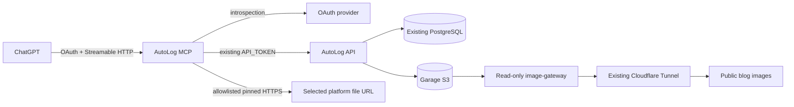

# AutoLog 단일 소스 MCP 서버

개발 원본은 이 저장소의 `work`다. Backend·CMS·MCP 도구/인증/파일 전송/작성 지침·테스트·컨테이너·Kubernetes 설정을 함께 관리한다. 기존 Sites 앱은 새 연결 검증 전까지 유지한다. 운영 배포나 기존 글 수정은 하지 않는다.

## 구조와 구현



MCP는 기존 backend image를 `uvicorn app.mcp_server:app`으로 별도 실행한다. MCP에는 DB/S3 key/admin password를 주입하지 않는다. 글 및 Garage 저장은 기존 backend API만 담당한다.

| 구현 | 위치 |
| --- | --- |
| Stateless Streamable HTTP JSON-RPC | `backend/app/mcp_server.py` |
| 11개 도구·기존 API adapter | `backend/app/mcp_tools.py` |
| OAuth resource/scope/subject 검증 | `mcp_auth.py`, `mcp_config.py` |
| 파일 allowlist·DNS 검증·TLS IP pinning | `mcp_files.py` |
| 기존 Sites에서 가져온 작성 지침 | `mcp_guidelines.md` |
| opt-in private reads | `mcp_read_api.py`, 기존 articles 쿼리 재사용 |
| 개발 실행 | `mcp.env.example`, `docker-compose.mcp.yml` |
| 배포 준비 | `k8s/mcp/`, 기존 Tunnel용 example fragment |

기존 Sites의 check_connection, get_writing_guidelines, list_categories, list_tags, search_articles, get_article, create_article, update_article, upsert_article, delete_article를 조사하고 upload_image를 추가했다. 기존 작성 지침은 도구로 읽어 저장소로 옮겼다. 기본 draft, 명시적 발행/삭제, 기존 내용 유지, 버전 충돌, 민감정보 제거를 유지한다. 성공한 글 응답에는 article_url을 추가한다. published는 공개 링크, draft는 관리자 로그인이 필요한 편집 링크다.

Sites 서버 소스는 미확보다. 소스 Git DNS 실패 외에 버전 조회를 조사했고 현재 게시 source SHA `10676e9f5a6054649ed93957f1cffb326d12363d`와 archive 존재를 확인했다. 제공된 도구에는 archive bytes 조회 경로가 없었다. 접근 권한 거부로 단정하지 않는다. 새 서버는 Sites 내부 구현에 의존하지 않는다.

## ChatGPT 인증과 프로토콜

[OpenAI 연결 안내](https://developers.openai.com/api/docs/guides/custom-mcp-server)는 읽기/쓰기, Streamable HTTP와 OAuth를 지원한다. [인증 문서](https://developers.openai.com/plugins/build/auth)에 따라 외부 OAuth provider를 사용하는 resource server로 구현했다. 정적 GPT Actions API Key 입력을 MCP 인증 방식으로 가정하지 않는다.

Provider 관리자가 준비할 항목:

1. 정확한 MCP HTTPS URL을 resource/audience로 등록한다.
2. Authorization code + PKCE S256, 필요 시 refresh/offline_access를 설정한다.
3. ChatGPT용 client를 사전 등록하고 실제 연결 UI의 redirect URI만 허용한다. DCR/CIMD는 provider가 실제 지원할 때만 사용한다.
4. OAuth/OIDC metadata에 issuer, authorize/token endpoint, 지원 client 인증 방식과 S256이 있어야 한다.
5. 별도의 resource-server introspection client를 준비한다. 그 secret은 ChatGPT client secret과 다르다.
6. owner의 정확한 sub와 autolog:read/autolog:write scope를 설정한다.

MCP는 매 요청 RFC7662 introspection의 active/iss/aud/exp/sub/scope를 검사한다. 설정 누락/provider 장애는 fail closed한다. 401 WWW-Authenticate에는 보호 자원 discovery 위치를, scope 부족에는 403 challenge를 반환한다. Provider가 issuer/audience/expiry를 introspection에 반환하도록 설정해야 한다. 개인 AutoLog 하나를 위한 subject allowlist 구조이며 다중 tenant 라우터가 아니다.

OAuth token은 provider 검증에만 사용하고 backend에는 기존 API_TOKEN만 보낸다. 두 credential을 혼용하거나 caller token을 backend로 passthrough하지 않는다. Secret·원본 signed URL·payload를 로그나 응답에 노출하지 않는다.

[MCP HTTP 규격](https://modelcontextprotocol.io/specification/2025-06-18/basic/transports)에 맞춰 initialize/ping/tools/list/tools/call/notification을 구현했다. 버전 2025-06-18/2025-03-26을 협상한다. JSON response 방식으로 SSE server push가 필요 없어 GET /mcp는 405다. Notification은 202이며 쓰기를 실행하지 않는다. Session ID 없이 stateless로 동작한다. Host/Origin, Content-Type/Accept, 전체 request 1 MiB와 body timeout을 검증한다. 실제 ChatGPT handshake/PKCE 왕복은 아직 미검증이다.

## 이미지 경로

[공식 file input 계약](https://developers.openai.com/plugins/reference#define-file-inputs)에 따라 image는 `{download_url,file_id,mime_type?,file_name?}`이고 alt는 필수다. Schema는 네 string 속성을 모두 선언하며 파일 객체의 required는 download_url/file_id만 둔다. `openai/fileParams=["image"]`를 등록한다. 바이너리나 sandbox 경로를 MCP JSON으로 받지 않는다.

실제 파일 source hostname/path를 관찰하지 못했으므로 FILE_SOURCES 기본값은 빈 객체다. 이때 upload_image는 503이며 글 도구는 사용할 수 있다. 관찰한 정확한 hostname과 `/`로 끝나는 path prefix만 설정한다. file_id는 소유권 증명이 아니다. 허용된 OAuth owner가 제공한 capability URL을 source의 서명/접근 검사로 읽는 구조다. 플랫폼이 사용자별 소유권을 암호학적으로 보증한다고 주장하지 않는다. 조직이 별도 소유권 attestation을 요구하면 그것이 준비될 때까지 업로드를 켜지 않는다.

다운로드는 HTTPS/443와 정확한 host/path만 허용한다. IP literal, private/loopback/link-local/metadata, 혼합 public/private DNS 응답, 경로 우회와 redirect를 거부한다. 검증한 공인 IP에 직접 연결하고 원래 hostname으로 TLS 인증서/SNI를 검증해 DNS 재바인딩을 막는다. Source에 AutoLog Authorization/Cookie를 보내지 않는다. 압축을 요청하지 않으며 압축 응답도 거부한다. Content-Length/실제 수신 bytes 모두 10 MiB cap, 연결/read timeout과 읽기 15초 deadline을 적용한다. OS DNS resolver timeout은 배포 환경에서 설정해야 한다. 45초 전체 도구 deadline이 OS DNS thread를 강제 종료하는 것은 아니다.

Bytes에서 MIME 힌트를 얻고 기존 multipart `/api/uploads`로 전송한다. 최종 Pillow decode/MIME/40 MP/100프레임, UUID key, Garage 저장을 재사용한다. SVG는 거부한다. 성공 응답의 URL/key/UUID4/확장자를 확인한 후에만 Markdown을 만든다.

Subject+실제 image hash의 성공 결과를 process에 최대 100개/10분 보관하며 bytes는 cache하지 않는다. 이미지 처리 동시성은 process당 하나다. 재시작/여러 Pod/응답 불명 상태에 대한 영속 멱등성은 없다. 자동 쓰기 재시도는 하지 않는다. 글 저장 실패만으로 이미지를 재업로드하지 않는다. 이미지와 글 저장은 원자적 트랜잭션이 아니다.

## 초안 읽기 opt-in

기존 `/api/articles`의 공개 GET 정책은 그대로다. 초안까지 MCP에서 수정하려면 backend `MCP_PRIVATE_READS_ENABLED=true`와 MCP `AUTOLOG_MCP_PRIVATE_READS=true`를 함께 명시적으로 켠다.

새 `/api/integrations/articles` 및 `/{id}`는 기존 API token 검증이 필수이며 cookie만으로 접근할 수 없다. 기존 query/read 코드를 재사용해 draft/private source_reference를 읽는다. 기존 write token에 별도 경로의 private-read 권한을 부여하는 변경이므로 운영자 검토 후 opt-in한다. 기본값 false는 503, 공개 GET/CMS 인증은 유지, DB migration은 없다.

## 개발 실행·테스트

`mcp.env.example`을 보호된 Git 밖 `.env.mcp`로 복사하고 기존 token과 provider 설정을 서버에서 입력한다. 채팅으로 토큰을 받지 않는다. MCP는 backend .env를 자동으로 읽지 않는다.

```bash
cd backend
.venv/bin/uvicorn app.mcp_server:app --env-file ../.env.mcp \
  --host 127.0.0.1 --port 8080 --workers 1 --limit-concurrency 8 --no-access-log
# _test 전용 PostgreSQL. 운영 DB는 사용하지 않는다.
TEST_DATABASE_URL="$YOUR_DEDICATED_TEST_DATABASE_URL" .venv/bin/python -m pytest -q
# DB/소켓이 필요 없는 검증:
TEST_DATABASE_URL=postgresql+psycopg://localhost/autolog_test \
  .venv/bin/python -m pytest -q tests/test_mcp.py tests/test_image_validation.py tests/test_upload_guard.py
cd ../frontend
node --test tests/upload-proxy.test.cjs tests/image-upload.test.cjs
npm run typecheck
npm run build
```

제약 환경은 `AUTOLOG_BUILD_WORKER_THREADS=1 npm run build`를 사용한다. 타입 검사는 생략하지 않는다. Container 개발은 기존 개발 compose에 docker-compose.mcp.yml을 합친다. Backend 주소는 compose service로 설정된다. 운영 스택에서 실행하지 않는다. 새 미고정 SDK 의존성 없이 기존 backend requirements lock을 사용한다.

CI는 임시 PostgreSQL backend 전체, gateway 전체, frontend tests/build 및 MCP manifests를 검사한다. Push는 GHCR image를 만들 수 있지만 Kubernetes deploy workflow는 수동 전용으로 유지한다.

## 승인 후 배포 및 전환

아래는 준비 절차이며 이번 작업에서 운영 배포하지 않는다.

1. CI 통과 backend image를 검토하고 k8s/mcp image placeholder를 immutable SHA overlay로 바꾼다. 같은 image에서 별도 command로 실행한다.
2. Provider/client/owner sub, public hostname/TLS, 실제 file source 정책을 준비한다. OAuth secret은 example의 이름/키만 제공하며 실제 값은 Git 밖에서 입력한다. 기존 API/Garage/DB Secret은 교체하지 않는다.
3. 필요 시 backend private-read opt-in을 검토한다. MCP에는 DB/S3 key나 관리자 password를 넣지 않는다.
4. `kubectl kustomize k8s/mcp`와 server dry-run/admission을 검토한다. Ingress는 cloudflared, egress는 backend/DNS/public HTTPS다. 실제 Cilium FQDN으로 source/provider를 좁히고 기존 정책과 합산 권한을 검토한다. IPv6-only source는 현재 egress 예제가 허용하지 않는다.
5. 기존 Tunnel에 cloudflared-mcp-ingress example fragment를 합친다. 기존 Sites/AutoLog/image route나 tunnel credential을 교체하지 않는다.
6. 내부 health/API 연결, 외부 보호 자원 metadata와 /mcp challenge를 검사한다.
7. ChatGPT Add custom MCP server에서 새 URL과 OAuth client를 연결한다. Custom MCP 사용 권한과 IdP 관리 권한이 필요하다.
8. 새 연결을 명시적으로 선택해 read-only 도구 → 개발용 글 CRUD/충돌 → 실제 screenshot/생성 이미지 → Garage hash → gateway GET/HEAD/MIME/404/405 → 공개 테스트 페이지 표시를 검증한다. 운영 기존 글을 smoke test로 수정하지 않는다.
9. 새 연결이 검증된 뒤에만 기본 연결을 바꾼다. 기존 Sites는 그 전까지 유지한다. Rollback은 새 MCP 버전/연결을 복구하고 기존 Sites를 사용한다. DB/Garage objects는 유지한다.

남은 외부 작업은 IdP/client/subject 설정, ChatGPT 연결 승인, 실제 FileRef 정책 확정과 DNS/Tunnel/Kubernetes/Garage 통합 검증이다. Resource-server/auth/file/API adapter 코드는 저장소에 구현되어 Sites 소스 없이 테스트할 수 있다.

## 홈랩 인증 서버 구축

IdP가 없는 환경의 후보 비교·독립 배포·실제 OAuth 검증·운영 복구는 [홈랩 인증 서버 배포 준비](mcp-auth-homelab.md)를 따른다. Authelia는 실증 전 후보이며 ChatGPT 연결 성공으로 간주하지 않는다. MCP는 introspection의 bearer access-token 종류도 검증하고 선택적 `AUTOLOG_MCP_SUBJECT_SCOPES`로 사용자별 scope 상한을 적용한다. 기존 Sites와 운영 서비스/Secret은 유지한다.
